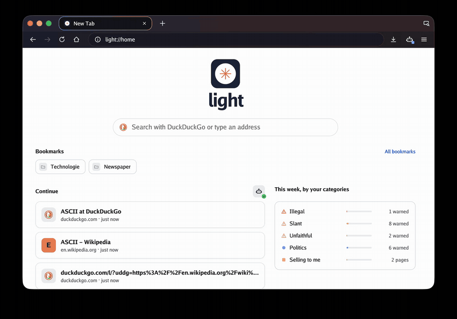

#  light

**A web browser written from scratch in Go.** 
No WebKit. No Chromium. No Gecko. No system web view.

A search, Wikipedia, and the model on the device explaining and translating a selection. Sped up 2.5 times.

**[lantervale.github.io/light](https://lantervale.github.io/light/)** · **[Download](https://github.com/lantervale/light/releases)** · [Reference](docs/reference.md) ·
[The model](docs/model.md) · [Build it](docs/development.md)

> [!WARNING]
> **A very early preview, not even an alpha.** Its security is not hardened yet: do not open sensitive pages with
> it, and do not type a password, a card number or any other secret anywhere in it. light says so itself at its
> first start.

## Why

Almost every browser is one of three engines. light is none of them: it parses the CSS, lays out the page, shapes
the text and paints it with its own code, on [ember](https://github.com/lantervale/ember), a game engine in Go.
It exists to see how far that goes on the real web.

| Part | Whose |
|---|---|
| CSS, layout, text, painting | **ours**, in ember's `ui`, checked against headless Chrome |
| DOM and web APIs (`fetch`, storage, IndexedDB, frames, modules…) | **ours**, in Go |
| Cookies, CORS, mixed content, request headers | **ours** |
| Tabs, windows, history, bookmarks, downloads, developer tools | **ours**, drawn like the page, on the GPU |
| JavaScript | V8, through [gost-dom/v8go](https://github.com/gost-dom/v8go) |
| HTML parsing | [golang.org/x/net/html](https://pkg.go.dev/golang.org/x/net/html) |
| Network | Go's standard library |

Everything borrowed is listed in the [reference](docs/reference.md#under-the-hood).

| | |
|---|---|
|  |  |
|  |  |

## What you get

- **A browser around the page**: tabs, windows, bookmarks, history, downloads, find in page, zoom, view source.
- **Developer tools**: Inspector, Network with HAR export, Console, Warnings, Storage.
- **Privacy by default**: nothing is sent while you type, no telemetry, no update check, third-party cookies
  blocked, an honest User-Agent, and a page of the Internet cannot reach your local network.
- **It follows your system**: dark mode and languages, each of which the settings override.
- **An optional model on your device** (experimental, off by default): ask a question of the page, translate it,
  explain a selection, find by meaning, sort pages into categories of your own. Nothing leaves the machine.
  [More](docs/model.md).
- **WebDriver**: `light drive` lets a test runner drive it, on this machine only.

## Install

Take the archive of your system from the [releases](https://github.com/lantervale/light/releases):

| System | JavaScript |
|---|---|
| macOS 13+, Apple silicon or Intel | yes |
| Linux x86-64 or arm64 (glibc 2.35+) | yes |
| Windows 10+, x86-64 | **no**: pages show without their scripts |

- **macOS**: move `light.app` to Applications. It is not notarized, so the first launch is refused: choose
  **Open Anyway** in System Settings → Privacy & Security, or run
  `xattr -dr com.apple.quarantine /Applications/light.app` once.
- **Linux**: run `./light` from its folder. It needs Vulkan, X11 and ALSA:
  `sudo apt install libvulkan1 libx11-6 libxrandr2 libxinerama1 libxcursor1 libxi6 libxxf86vm1 libasound2`.
- **Windows**: run `light.exe` from its folder.

Checksums are signed with cosign and each archive has its SBOM. From source: [Build it](docs/development.md).

## What does not work yet

Plenty. Many pages show well, many do not.

- No canvas, audio or video; no workers, WebSockets or service workers.
- No shadow DOM or custom elements; CSS is a [subset](https://github.com/lantervale/ember/blob/main/docs/05-ui/10-missing.md).
- No HTTP cache, no file upload, no HTTP sign-in, no Content Security Policy.
- No extensions, sync, private window, password manager or printing.
- One process: V8 isolates are the only wall between sites.

Of the [web-platform-tests](https://web-platform-tests.org) light runs, 461 of 625 pass (19 November 2026): a
subset, mostly `dom/` and `domxpath/`, not all of WPT ([per directory](docs/reference.md#web-platform-tests)).

The honest, full list is in the reference: [what works and what does not](docs/reference.md#what-works-and-what-does-not).

## Go further

- [Reference](docs/reference.md): the address field, shortcuts, settings, what light tells a site, frames,
  downloads, WebDriver, web-platform-tests, under the hood.
- [The model on this device](docs/model.md): what it does, what it downloads, how it is kept apart.
- [Building, testing and releasing](docs/development.md).

## Licence

Code under [MIT](LICENSE). The pages in the screenshots belong to their authors. V8, wgpu-native, llama.cpp and
the models have their own licences; the archives carry those of what they ship.
