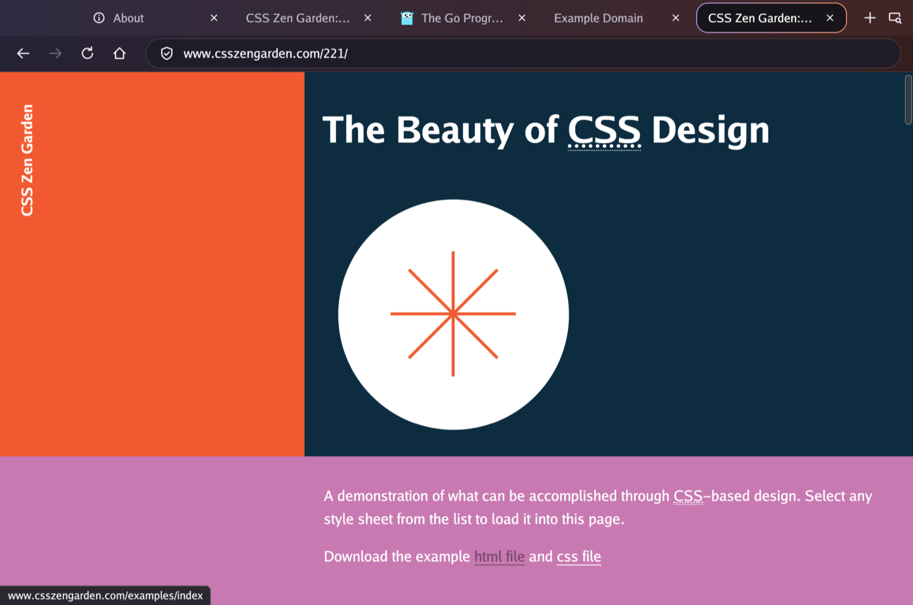

<div align="center">

# explorer

**A small web explorer, made as a demo of [ember](https://github.com/lantervale/ember).**

[](go.mod)
[](LICENSE)
[](#what-it-does-not-do)
[](https://github.com/lantervale/ember)



<sub>[CSS Zen Garden](https://csszengarden.com/221/), fetched from the web and drawn by ember.</sub>

</div>

ember is a 2D game engine in plain Go. Its UI is HTML elements built from Go and styled by a CSS subset. This demo asks
how far that UI goes on pages written for real browsers: it fetches a page, turns it into ember elements and draws it.

It is not a browser, and it does not try to become one.

## Highlights

- 🗂️ **Tabs in the title bar**: the header sits where the system's title bar is, as a browser's does (macOS).
- 🧭 **Navigation**: back, forward, reload and stop, an address field, a list of the open tabs, favicons.
- 🌐 **Real pages**: an `http` or `https` address is fetched with its stylesheets and pictures.
- 🖼️ **Pictures**: PNG, JPEG, GIF and SVG.
- ✂️ **Text you can select** and copy.
- ⌨️ **Shortcuts**: Cmd/Ctrl+T, W, L, R, `[` and `]`.
- 🧱 **All of it is ember**: the header, the status bubble and the page are plain ui elements and one stylesheet.

## Get started

You need Go 1.27, [Task](https://taskfile.dev) (`brew install go-task`) and a
[WebGPU-capable GPU](https://github.com/lantervale/ember/blob/main/docs/01-getting-started/README.md).

The explorer builds on the ember cloned beside it, through a Go workspace:

**1.** Clone ember and the explorer side by side, and tie them:

```sh
mkdir lantervale && cd lantervale
git clone https://github.com/lantervale/ember.git ember
git clone https://github.com/lantervale/explorer.git explorer
go work init ./ember ./explorer
```

**2.** Fetch ember's WebGPU library (one time only):

```sh
(cd ember && task wgpu)
```

**3.** Run it:

```sh
go run ./explorer
```

The start page has a tile for CSS Zen Garden; any address typed in the field works the same way.


> ⚠️ The explorer does not build against ember's `main` yet: it uses parts of ember's ui that have not landed there
> so far. Until they do, `go.mod` pins an older commit and the steps above fail at the build.

## What it does not do

- It runs no script. A page that builds itself in JavaScript shows little, and fonts a script loads are replaced.
- It sends no form, keeps no cookie, and remembers nothing between runs.
- It draws what ember's ui draws. What is missing is listed in ember's guide:
  [What is missing](https://github.com/lantervale/ember/blob/main/docs/05-ui/10-missing.md).

## Under the hood

A page goes through four steps:

1. **Fetch**: the page, then each `<link rel="stylesheet">` and `<style>` block.
2. **Read the HTML** with [golang.org/x/net/html](https://pkg.go.dev/golang.org/x/net/html). ember has no HTML parser.
3. **Build**: each element becomes the ember element of the same name (`ui.Div`, `ui.P`, `ui.Img`…), with its id,
   classes, inline style and attributes.
4. **Style and draw**: the sheets go to ember as they are. ember parses the CSS, lays the page out and draws it.

What the explorer changes in a page before showing it is one short table in `adaptations.go`. The explorer shows it at
`ember://about`.

| File | What it holds |
|------|---------------|
| `main.go` | The window and the World. |
| `explorer.go` | The header, the navigation row, the status bubble, the tabs. |
| `rules.go` | Plain Go, no ember: a tab's history, what a typed address means. |
| `pages.go` | The explorer's own pages: `ember://home`, `guide`, `examples`, `about`. |
| `web.go` | Fetching a page and building it as a ui Document. |
| `adaptations.go` | Every change made to a page so ember can show it. |
| `icons.go` | The header's icons, as SVG. |

## Development

The tests need no GPU and no network: pages are served by a local test server, and clicks and keys are simulated.

```sh
cd explorer
go test ./...
go vet ./...
```

A screenshot without opening a window:

```sh
EMBER_HIDDEN=1 EMBER_CAPTURE=shot.png EMBER_CAPTURE_FRAME=30 go run ./explorer
```

## Licence

Code under [MIT](LICENSE). The pages in the screenshots belong to their authors.
