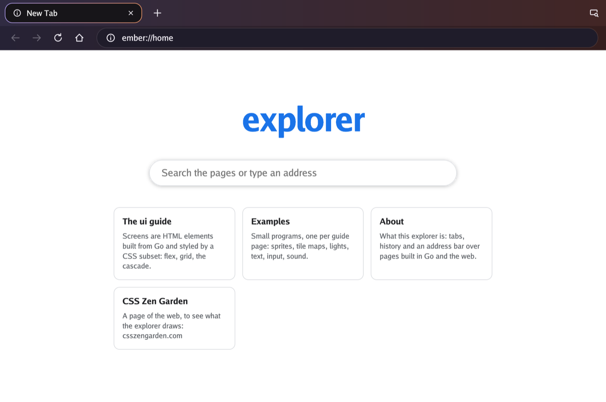
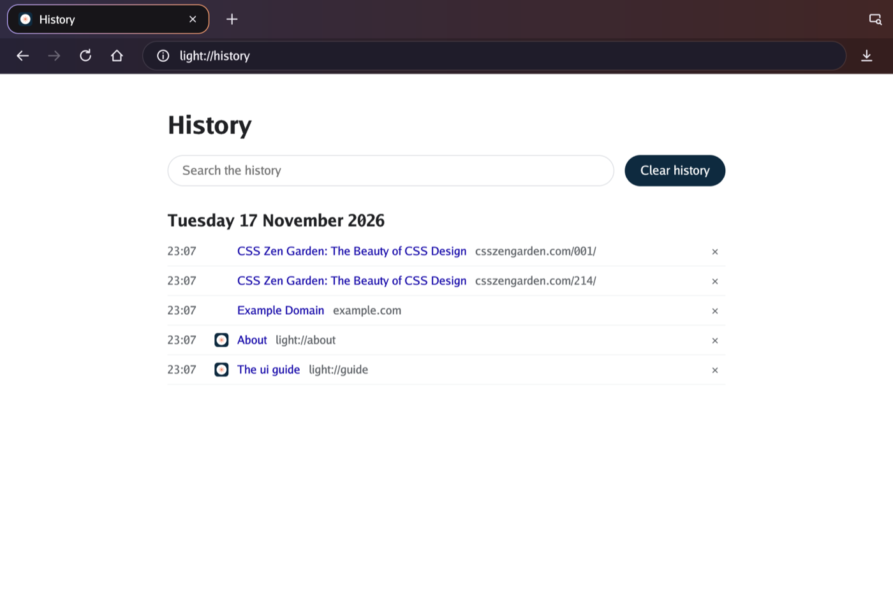
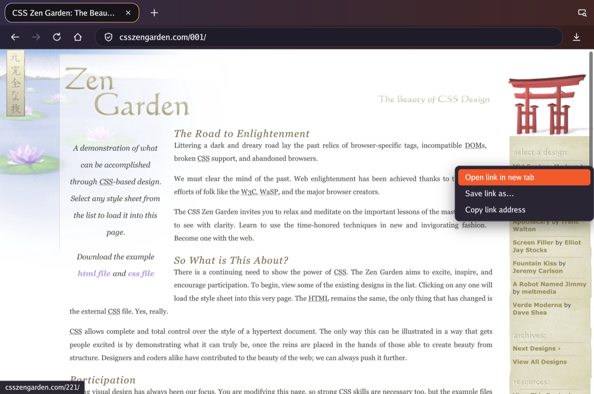
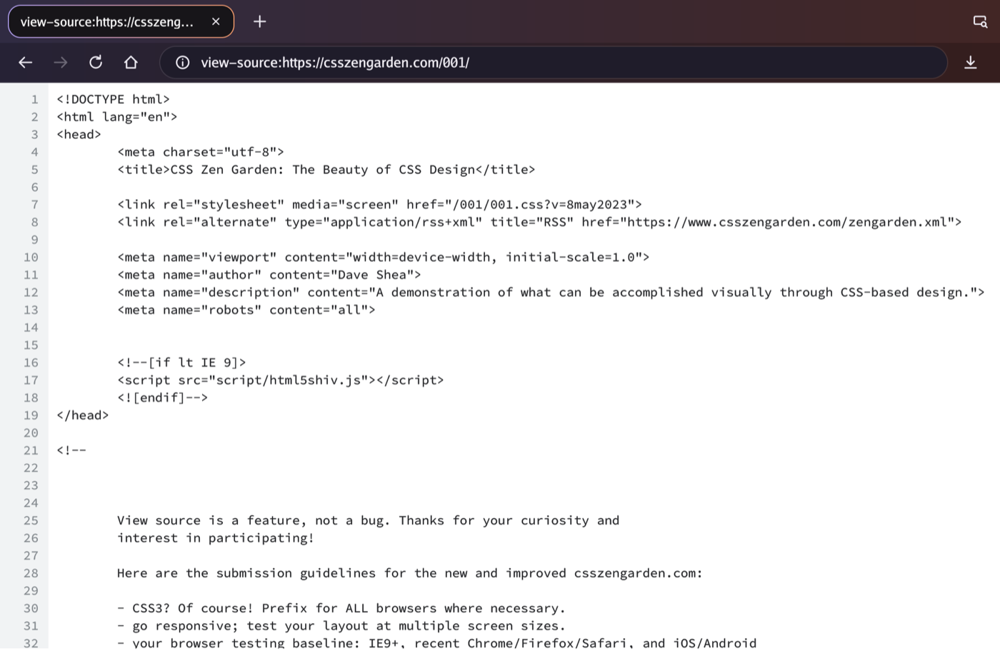
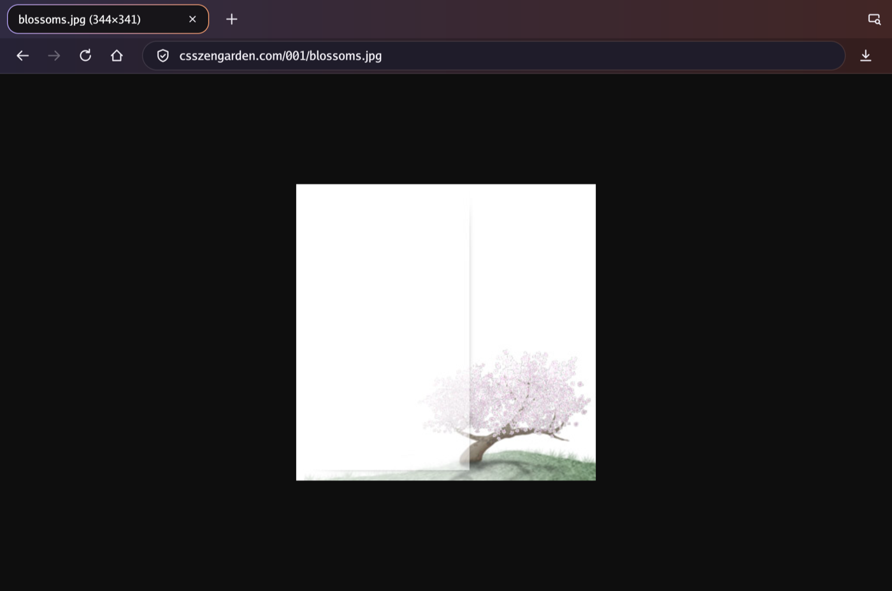

<div align="center">

#  light

**A small web browser, made as a demo of [ember](https://github.com/lantervale/ember).**

[](go.mod)
[](LICENSE)
[](#what-it-does-not-do)
[](https://github.com/lantervale/ember)


<sub>[CSS Zen Garden 001](https://csszengarden.com/001/), fetched from the web and drawn by ember.</sub>

</div>

ember is a 2D game engine in plain Go. Its UI is HTML elements built from Go and styled by a CSS subset. This demo asks
how far that UI goes on pages written for real browsers: it fetches a page, turns it into ember elements and draws it.

It is a demo, not a browser to live in: see [what it does not do](#what-it-does-not-do).

## Highlights

- 🗂️ **Tabs in the title bar**: the header sits where the system's title bar is, as a browser's does (macOS).
- 🪟 **Windows**: Shift+click on a link or Cmd+N opens another window, with its own tabs; they share the settings,
  the history, the cookies and the downloads, and light ends with the last one.
- 🧭 **Navigation**: back, forward, reload and stop, an address field, a list of the open tabs, favicons.
- 🌐 **Real pages**: an `http` or `https` address is fetched with its stylesheets, pictures and fonts, through its redirects.
- 🪟 **Frames**: an `iframe` shows its document, another site's included, in the page: its `src` or its `srcdoc`,
  its own sheets, pictures, links and forms. A document that refuses to be framed is not shown, and a frame gets
  the cookies of its tab's site alone ([below](#frames)).
- 🧾 **Other kinds of answer**: a picture alone on a dark page (PNG, JPEG, GIF, WebP, SVG, an ICO holding a PNG; a
  click switches between fitted and its own size), text kinds (CSS, JavaScript, JSON, XML, plain text…) as they were sent.
  The rest (PDF, archives, audio, video, fonts, AVIF…) is downloaded.
- ⬇️ **Downloads**: a button in the navigation row with the progress and the latest files, and `light://downloads`
  with all of them: open, show in folder, cancel, retry, remove. A link with `download`, "Save link as…",
  "Save image as…" and "Save page as…" go the same way.
- ⚙️ **Settings**: `light://config` sets the start page, the dark mode, the downloads folder, the history, the zoom,
  pictures, timeouts, redirects and the User-Agent. They apply at once and are kept between runs.
- 🌙 **Dark mode**: light's own pages on black, the logo's navy and white swapped, and "light" struck through. A
  click on the start page's logo switches it; pages of the web stay as their sites made them.
- 🏠 **Its own pages**: `light://home`, `guide`, `examples`, `scripts`, `about`, `history`, `downloads` and `config`.
- 🕘 **History**: `light://history` lists every visit by day, filtered as you type, kept between runs.
- 🖱️ **Right click**: a menu for what is under the pointer — a link, a picture, selected text, a text field, the
  page, a tab, a request.
- 📄 **View source**: `view-source:<address>`, with line numbers.
- ⚡ **JavaScript**, in a build with the `v8` tag: a page's scripts, classic and modules, run in V8 against a DOM of light's own:
  the page as its parser made it, of which ember draws what it has an element for. Elements, events, timers, `fetch`, `localStorage`, `history`. `light://scripts` shows it.
- 🍪 **Cookies**: one jar for every request, by the rules browsers apply (`Secure`, `HttpOnly`, `SameSite`, the
  public suffixes), kept between runs; those of other sites than the page's are blocked unless the settings say
  otherwise (below).
- 🛠️ **Developer tools**, in the manner of Firefox's: a tool bar of tabs, a panel whose top edge is dragged to size
  it, dark or light as the dark mode says. Its Network tab lists every request of the tab (below), its Console tab
  what the page said (below), its Warnings tab what ember's ui refused, and its Storage tab the cookies and the
  `localStorage` of the page's site, to read only, as they stood when the tab was shown.
- 🔍 **Zoom**, from 80 % to 200 %, and **text you can select** and copy.
- 🧱 **All of it is ember**: the header, the menus, the tools and the page are plain ui elements and stylesheets.

| | |
|---|---|
|  |  |
|  |  |
|  |  |
|  |  |

## Get started

You need Go 1.27, [Task](https://taskfile.dev) (`brew install go-task`) and a
[WebGPU-capable GPU](https://github.com/lantervale/ember/blob/main/docs/01-getting-started/README.md).

light builds on the ember cloned beside it, through a Go workspace:

**1.** Clone ember and light side by side, and tie them:

```sh
mkdir lantervale && cd lantervale
git clone https://github.com/lantervale/ember.git ember
git clone https://github.com/lantervale/light.git light
go work init ./ember ./light
```

**2.** Fetch ember's WebGPU library (one time only):

```sh
(cd ember && task wgpu)
```

**3.** Run it, on the start page or at an address:

```sh
cd light
go run ./cmd/light
go run ./cmd/light https://csszengarden.com
```

The start page has a tile for CSS Zen Garden; any address typed in the field works the same way.

That build runs no script. The JavaScript engine is V8 (through [gost-dom/v8go](https://github.com/gost-dom/v8go)
and cgo), behind the `v8` build tag, on macOS and Linux, amd64 and arm64:

```sh
task run                                                      # or:
CGO_CXXFLAGS=-nostdinc++ go run -tags v8 ./cmd/light light://scripts
```

V8's headers need its own libc++, hence `CGO_CXXFLAGS`. The binary grows from about 34 MB to about 106 MB.
Without the tag, or on Windows, light builds as before and `light://config` says no engine is built in.

> ⚠️ light does not build against ember's `main` yet: it uses parts of ember's ui that have not landed there
> so far. Until they do, `go.mod` pins an older commit and the steps above fail at the build.

## Shortcuts

Cmd is Command on macOS and Control elsewhere.

| Keys | What they do |
|------|--------------|
| Cmd+T, Cmd+W | A new tab, close the tab (a window's last tab closes the window) |
| Cmd+N | A new window, on the start page |
| Cmd+Q | Quit, whatever the windows open |
| Cmd+L | The address field |
| Cmd+R | Reload, or stop a page that is loading |
| Cmd+[ and Cmd+] (Alt+Left and Alt+Right off macOS) | Back, forward |
| Cmd+Y on macOS, Ctrl+H elsewhere | The history |
| Cmd+Shift+J on macOS, Ctrl+J elsewhere | The downloads |
| Cmd+, | The settings |
| Cmd++, Cmd+-, Cmd+0 | Zoom in, zoom out, the actual size |
| Cmd+Alt+U on macOS, Ctrl+U elsewhere | The page's source, in a new tab |
| F12, or Cmd+Alt+I on macOS, Ctrl+Shift+I elsewhere | The developer tools |
| Alt+Up and Alt+Down, or Ctrl+P and Ctrl+N, in the console's line | What was typed before, and after |
| Right click | The menu of what is under the pointer; arrows, Enter and Escape work in it |
| Cmd+click or a middle click on a link | The link in a new tab, behind the shown one |
| Cmd+Shift+click or Shift with a middle click on a link | The link in a new tab, shown |
| Shift+click on a link | The link in a new window |
| Middle click on a tab | Close the tab |

A tab opened by such a click stands after the shown one and those it opened already, and a page of the web loads in
it at once. The links of light's own pages (the start page's tiles, the rows of the history) open the same way. A
page's scripts hear a Cmd+click as a click with its keys (`metaKey`, `ctrlKey`, `shiftKey`), and may prevent it; they
hear nothing of a middle click.

A link or a form that asks for a window of its own (`target="_blank"`, or a name no frame of the page has) opens in
a new tab, shown, beside its own; the keys held at the click win over it. "Open image in new tab" in the menu of a
right click, and the links of the developer tools, open their tab behind the shown one, as "Open link in new tab"
does.

## Windows

Shift+click on a link, "Open link in new window" in the menu of a right click and Cmd+N open a window: the size of
the one it comes from, a little down and right of it, with tabs of its own. The windows share one profile: the
settings, the history, the cookies, what sites store and the downloads, so a setting changed in one window holds in
the others at once, and the history and the downloads pages list the same in each. The tabs, the developer tools,
the Network log and the Console are each window's own.

Closing a window stops what its tabs were loading and running, and leaves the other windows; light ends with the
last one, or at Cmd+Q, and writes its files then, once. Closing a window's last tab (Cmd+W, its close button, a
middle click on it, "Close tab" in its menu) closes the window.

## The developer tools

F12 opens them under the page, each tab its own. The tool bar has a tab for each tool, the count of the console's
errors in red (a click shows them), Preserve log and the close button. The top edge of the panel is a handle: drag it
to size the panel, between 120 points and the window less 80; a double click on it gives the panel its own height
back. The height is kept between runs (`tools_height` in `config.json`).

### Inspector

The Inspector tab shows the page as its markup, in three panes, read-only:

- **The tree**: elements with their attributes, text cut short, the doctype of a page of the web. The first two levels
  are open, the rest opens at a click on its triangle, and an element of more than 200 children lists them 200 at a
  time. A click selects a row; Up and Down move by a row, Left closes or goes to the parent, Right opens or goes to the
  first child. `flex`, `grid` and `scroll` badges tell what an element is. The tree follows the page as scripts change
  it and keeps the selection while its node lives. Search HTML finds by tag, `#id`, `.class` or text, Enter going to the
  next match.
- **On the page**: the element under the pointer in the tree is tinted, content, padding, border and margin each in
  its colour, with a label of its tag, id, classes and size; the selected one keeps a dashed outline while the
  Inspector shows. The picker, the button left of the search, selects the element clicked in the page without the
  page getting the click, Escape leaving it; "Inspect element" in the menu of a right click does the same. In the
  console, `$0` is the selected element.
- **Rules and computed**: the rules that match the selected element, the strongest first, the style attribute among
  them, each with its sheet and line (a click opens the source), its `@media` and `@layer`, what another declaration
  overrides struck through. Beside them its box, margin to content, and its computed style: what was declared or
  inherited, or every property with Browser styles ticked.

What it does not show: comments and the page's own doctype, which the Document does not keep, pseudo-element rules,
and declarations ember's ui refused (those are in Warnings). A page of light's own is inspected too.

### Network

- A row for each request, each hop of a redirect its own: its status on the colour of its kind, its method, its
  domain (a padlock for `https`), its file, who asked (the navigation, the document, a picture, an `iframe` or its frame, or the script and
  the line of a `fetch` or an `XMLHttpRequest`), its type in a word (`html`, `css`, `js`, `json`, `png`…), the bytes
  the server sent, those read once a gzip encoding is undone, and how long it took.
- A script's request light does not send (an `http` address asked by an `https` page, another origin asked in
  `same-origin` mode) and one whose answer is kept from the script (CORS) are blocked rows, with their sign and the
  reason in their details; a failed one is tinted. The preflight of a script's request is a row of its own, an
  `OPTIONS` of type `preflight`, before the request it asks leave for.
- The chips keep one kind: All, HTML, CSS, JS, XHR (what scripts asked for through `fetch`, `XMLHttpRequest` or
  `sendBeacon`, whatever was answered, and their preflights), Fonts, Images, Media, Other. There is none for WebSockets: light opens none. The field
  filters by address.
- A click on a column's name sorts by it, a second the other way, a third no more.
- A click on a row shows its headers and its response beside the table, the `Cookie` header it was sent with and
  the `Set-Cookie` headers it was answered among them; the pointer over a row names its address
  in the status bubble. The bin empties the list; a new page does too, unless Preserve log is checked.
- The arrow beside the bin saves the requests as a HAR 1.2 file, the one Chrome's and Firefox's Network panels
  import, to hand a whole exchange to someone else: those the filters list, as Firefox does, in the order they were
  asked. It goes to the downloads folder as `<host>-<date>-<time>.har`, never over another file, is listed among the
  downloads, and the status bubble says where it is. A right click on a row copies or saves that request alone
  (Copy as HAR, Save as HAR), or saves them all; a right click on the arrow or the table saves them all.
- A HAR file holds a page for each navigation and an entry for each request, each hop of a redirect, the requests
  light refused to send and those that failed (status 0, the reason in `_blocked` or `_error`) included: the
  headers as they were sent and answered, the `Cookie` and `Set-Cookie` among them, the query and the cookies
  parsed, what a POST carried with a form's fields, the body of the answer as text by its charset or in base64,
  its size read and its size sent, the server's address, and how long it waited for a connection, looked the host
  up, connected, did the TLS handshake, sent, waited and received. `_kind` is the request's kind, `_initiator` who
  asked.
- A tab keeps the bodies for it from its first request, tools open or not, so the request that went wrong is in
  the file: up to 4 MB of a body and 32 MB a tab, the oldest going first down to the 256 kB the Response view
  shows. A body that is not whole says so (`_truncated` and a `comment`), and its sizes are still the real ones.
  The bodies go when the list does.
- **A HAR file holds secrets.** Every entry is there twice in the menus: *sanitized*, which the arrow saves, and
  *with sensitive data*. Sanitized, as Chrome's export is, the values of the `Cookie`, `Set-Cookie`,
  `Authorization` and `Proxy-Authorization` headers and of the cookies read `[redacted]`. Nothing else is taken
  out: the addresses with their queries and the bodies are as they were sent, so a password typed in a form, a
  token in an address and whatever a page answered are in the file. Read it before you hand it on.

### Console

The Console tab of the developer tools lists what the shown tab's page said, the newest line last, and follows it
unless you scrolled up:

- `console.log`, `info`, `warn`, `error` and `debug`, warnings and errors on their tint with their sign, several values on a
  line printed as a console prints them (`{a: [1, "two"]}`, `<p#id.class>`, `ƒ name()`, an error with its stack),
  `%s %d %i %f %o %O` filled in and `%c` left out. `assert`, `count`, `time`/`timeLog`/`timeEnd`, `dir`, `trace` (with
  the calls that led there), `group`/`groupEnd` (indented), `table` (as plain text) and `clear` work too.
- The exceptions nothing caught and the promises rejected with no handler, as errors whose calls unfold at a click
  on their triangle; the scripts
  that did not load or were skipped; the requests of scripts that failed or were blocked, in a browser's words
  (`Access to fetch at '…' from origin '…' has been blocked by CORS policy: …`, `Mixed Content: …`).
- On the right of a line, the script and the line it is from: a click shows that script's source in a new tab, behind
  the shown one (at its top: the source view does not scroll to a line). An inline script's lines count from its own first. An
  address in a line is a link that opens it in a new tab, behind too.
- A line said again in a row is listed once, with how many times.
- The bar filters by text and by level: Errors, Warnings, Info, Logs and Debug are each on or off. XHR lists the
  requests of scripts among the lines (method, address, status and time), Requests every request, and CSS what
  ember's ui refused in the page's sheets; the three are off at first. The bin empties the console; a new page does
  too, unless Preserve log is checked.
- The line at the bottom evaluates in the page: Enter runs it, its value comes back under it (a string in its
  quotes) or the error it threw, and `$_` is the last value. A `let` or a `const` a line begins with stays for the
  next lines. Alt+Up and Alt+Down (or Ctrl+P and Ctrl+N) walk what was typed before in the tab. A page without a
  script gets its scripts' context the first time a line is run.
- The text selects and copies as a page's does.
- In a build without the engine, or with JavaScript off in the settings, the tab says so and its line takes nothing.

Not there: the arrows alone for the history and Shift+Enter for a line of several (ember's text field keeps its
keys to itself), completion, and values you can unfold.

## Settings

`light://config` (Cmd+,) shows them; a change applies at once and is written to `config.json`. A value out of its
bounds, or a file that does not read, falls back to the default, setting by setting.

| Setting | Default | Overridden by |
|---------|---------|---------------|
| Start page (a new tab, the home button) | `light://home` | The address argument, at launch only |
| Dark mode (light's own pages; a click on the start page's logo switches it too) | Off | |
| Downloads folder | The system's (`~/Downloads`) | `--downloads`, `LIGHT_DOWNLOADS` |
| Keep the pages visited | On | |
| Visits kept (100 to 100,000) | 2,000 | |
| Zoom of web pages (80 to 200 %) | 100 % | |
| Load pictures | On | |
| Load frames (the pages other pages show inside them) | On | |
| Run JavaScript (in a build with the `v8` tag; none runs otherwise) | On | |
| Follow a page that refreshes elsewhere at once | On | |
| Keep the cookies sites set, and send them back | On | |
| Those of other sites than the page's too (third-party cookies) | Off | |
| Let pages reach this machine and the local network | Off | |
| Request timeout (1 to 300 s) | 30 s | |
| Redirects followed (0 to 20) | 10 | |
| User-Agent | light's own (see [What light tells a site](#what-light-tells-a-site)) | |
| Languages (as `fr-FR, en`) | The system's | |
| Preserve the Network log in new tabs | Off | |
| Requests kept in each tab's Network panel (100 to 10,000) | 1,000 | |

Pictures, JavaScript and refreshes apply to pages loaded afterwards; frames are loaded, or emptied, at once. The page also clears the history, clears the cookies and resets every setting.
`--dir` (or `LIGHT_DIR`) names the folder the settings are kept in (see [below](#where-things-are-kept)); `light --help` lists the command line.

## What light tells a site

Every value light sends a server or shows a page's scripts is true of light, of the machine or of the request. None
names another browser's engine or brand (no `AppleWebKit`, `Chrome`, `Safari` or `Gecko` token in the User-Agent),
and nothing is said to exist that does not work. light sends no client hints (`Sec-CH-UA`) and has no
`navigator.userAgentData`. One function decides the headers of every request (`pkg/identity`).

| Header | What it says |
|--------|--------------|
| `User-Agent` | `Mozilla/5.0 (<platform>) light/<version>`: the platform as browsers froze it (`Macintosh; Intel Mac OS X 10_15_7`, `Windows NT 10.0; Win64; x64`, `X11; Linux x86_64`), the version of the build, `0.1.0-alpha` for one made by hand. The settings can replace it. |
| `Accept` | By what is asked for: a page `text/html,application/xhtml+xml,application/xml;q=0.9,image/webp,*/*;q=0.8`, a picture `image/webp,image/png,image/svg+xml,image/*;q=0.8,*/*;q=0.5` (no AVIF, which light does not read), a sheet `text/css,*/*;q=0.1`, the rest `*/*`. A script's `fetch` says its own. |
| `Accept-Language` | The system's languages (macOS: the user's preferred languages; elsewhere `LANGUAGE`, `LC_ALL`, `LC_MESSAGES`, `LANG`), as browsers list them: `fr-FR,fr;q=0.9,en-US;q=0.8,en;q=0.7`. `en-US,en;q=0.9` when the system names none. The settings can replace them; a script's `fetch` says its own. |
| `Accept-Encoding` | `gzip, deflate`, and `br` over https: the encodings light undoes. No `zstd`. |
| `Sec-Fetch-Dest`, `-Mode`, `-Site`, `-User` | What the request is for (`document`, `style`, `script`, `image`, `font`, `empty`), how it is made (`navigate`, `no-cors`, `cors`, `same-origin`), and from where: `none` for an address typed, a bookmark, a reload or a link of light's own pages, else `same-origin`, `same-site` or `cross-site` to the page that asks, worked out again at each redirect. `Sec-Fetch-User: ?1` only on a navigation an act of the user began: an address typed, a link clicked, a form submitted, a script's move while it hears a click. Sent to https addresses and to this machine only. |
| `Upgrade-Insecure-Requests` | `1` on navigations. |
| `Referer` | On every request a page makes, by the policy browsers have by default (`strict-origin-when-cross-origin`): the page's whole address within its origin, its origin alone to another, nothing from https to http. A font names its sheet. An address typed and a link of light's own pages send none. `<meta name="referrer">`, the `Referrer-Policy` header and `referrerpolicy` attributes are not read. |
| `Origin` | On a form's POST, and on a script's request where the standard asks for it. |

A link opened in a tab of its own (the command key, the middle button) is the player's own navigation: it says
`Sec-Fetch-Site: none` and no `Referer`. A font is asked for as a picture is (`no-cors`, no `Origin`).

Scripts read the same: `navigator.userAgent`, `appVersion` (the User-Agent after `Mozilla/`), `language` and
`languages` (those of `Accept-Language`), `platform` (`MacIntel`, `Win32`, `Linux x86_64`), `hardwareConcurrency`
(the machine's logical cores), `cookieEnabled` (the setting), and the constants every browser answers (`appName`
`Netscape`, `appCodeName` `Mozilla`, `product` `Gecko`, `vendor` empty). `plugins` and `mimeTypes` are empty,
`pdfViewerEnabled` and `javaEnabled()` false, `maxTouchPoints` 0, `doNotTrack` null, `onLine` always true. There is no
`deviceMemory`. `navigator.webdriver` is true when light is driven by something else than a person at its window:
ember's automation server (`EMBER_AUTOMATION`), a capture with its scripted input (`EMBER_CAPTURE…`) or a hidden
window (`EMBER_HIDDEN`).

light is not told its monitor's size, so `screen.width`, `height`, `availWidth` and `availHeight` are the window's,
as `outerWidth` and `outerHeight`; `screenX` and `screenY` are where the window is, `innerWidth` and `innerHeight`
the page's view, and `devicePixelRatio` the pixels a pixel of the page is drawn with (the display's scale times the
zoom). `Date` and `Intl` use the system's time zone.

## Frames

A page's `iframe` shows a document of its own, in ember's `iframe` element: light gives each one its own Document,
loaded as a page is, so its sheets style nothing around it. A frame's documents are part of its tab: their requests
are rows of the tab's Network panel, asked by `iframe` for the document and by `frame` for what it needs, and they
are in its HAR file.

- **What it shows**: its `srcdoc` when it has one, else the address of its `src`, read from the page that holds
  it; nothing for no `src`, `about:blank`, and any address that is not `http` or `https` (a `javascript:` or
  `data:` one runs and shows nothing, and the Console says so). A page is shown with its sheets, pictures and
  fonts, a text as it was sent; a picture alone, a file to download and the other kinds are not, and nothing is
  saved from a frame's address. A script that sets `src` or `srcdoc`, or adds or removes the element, is followed.
- **Scripts** of a frame's document run, each document in a JavaScript engine of its own
  ([below](#scripts-in-frames)): its script elements and modules, its timers, its `fetch`, its events. A frame
  whose `sandbox` has no `allow-scripts`, like any frame with JavaScript off, is shown as a page without scripts,
  what its `noscript` holds included, and a document with no script costs no engine.
- **Links and forms** of a frame open in it, with no entry in the tab's history: Back leaves the page, not the
  frame's last document, and a reload starts every frame again from its attributes. `target="_top"` opens in the
  tab, `_parent` in the frame around, a name in the frame of the tab that has it; `_blank` and a name no frame
  has open in a new tab of the window, shown. Cmd+click, a middle click and the menu of a right click open a frame's link in a
  tab as they do the page's. A form is sent, with a GET or a POST, where its target says.
- **Limits**: a tab's page holds 64 frames, 8 deep; one more stays empty, and so does a frame asked for the
  address of a page it is itself in. The Console says which.
- **Refusals**: a document answered with `X-Frame-Options: DENY`, or `SAMEORIGIN` when any page above it is of
  another origin, is not shown; nor is one whose `Content-Security-Policy` has a `frame-ancestors` that does not
  name every page above it (`'none'`, `'self'`, hosts with `*.` and ports, schemes). `frame-ancestors` decides
  alone when it is there, `ALLOW-FROM` is read as nothing, two `X-Frame-Options` that disagree refuse. It is
  checked on the answer's headers, after its redirects, before anything of it is read: none of its sheets or
  pictures is asked for. The frame shows a small notice, the Console says it as Chrome does, and the request is a
  blocked row of the Network panel.
- **Requests**: a frame's document is asked for as browsers ask (`Sec-Fetch-Dest: iframe`, `Sec-Fetch-Site`
  against the page that holds it, that page as `Referer`, `Sec-Fetch-User` only for a link you clicked in it). It
  is a page's request, not yours: a public page frames neither your router nor this machine
  ([Local network](#what-it-does-not-do)), at every hop of a redirect. Under a page that came over `https`, a frame
  at an `http` address is not asked for, nor a redirect to one (this machine's own addresses aside).
- **Cookies**: a frame of the page's own site, in pages of that site only, has the site's cookies. Any other is a
  third party: it gets none unless the settings let third-party cookies in, and then only those it was set as a
  frame under the same top-level site, kept apart (and written to `cookies.json` with that site). The same
  widget in two sites' pages has two jars, and neither is the one of a visit to the widget's own site.
- **Sandbox**: a frame with a `sandbox` attribute that does not say `allow-same-origin` has no origin: it and what
  it asks for carry no cookie and keep none, and its forms say they come from `null`. Its forms are not sent
  without `allow-forms`, whether a click or a script sends them, its links and its scripts do not leave the tab
  without `allow-top-navigation` (or `allow-top-navigation-by-user-activation`, on a click), a `_blank` link or a
  target no frame it reaches has goes nowhere without `allow-popups`, a `download` link saves nothing without
  `allow-downloads`, and a named target reaches only frames inside it. Without `allow-scripts` nothing runs;
  without `allow-modals` `alert`, `confirm` and `prompt` are refused in the Console. A frame in a sandboxed one is
  left what both allow, and a document keeps the sandbox it was loaded under until the frame shows another.
- **Not honoured**: the `frame-src` and `child-src` of the page's own Content-Security-Policy, `allow`
  (Permissions Policy), `loading="lazy"`, `referrerpolicy`, `csp`, `credentialless` and `scrolling`. A
  `frame-ancestors` in a `<meta>` is not read, as in browsers. The Inspector shows the `iframe`
  element, not the document in it, and "Inspect element" in a frame selects that element. The Warnings tab lists
  the page's, not its frames'. A menu or a dialog of a frame's document is clipped to the frame.

### Scripts in frames

Every document that runs scripts, the page's and each frame's, has a V8 engine (an isolate) of its own. Two
documents share no object, whatever their origins: what one knows of another goes through light, in Go, as text.

- **What runs**: classic scripts and modules (a module map a document), timers and `requestAnimationFrame`,
  `fetch` and `XMLHttpRequest`, the events of clicks and keys (a click goes to the document under the pointer, the
  keys to the document last clicked in, and no other hears of them), `load` and `error` on an `iframe` told to the
  document that holds it, at any depth. The Console tags a frame's lines with its host. A line typed in the
  Console runs in the page, not in a frame.
- **A document's identity** is set by light when it is shown and never read from its scripts: its origin (that
  of the address its answer came from, the parent's for a `srcdoc`, `null` in a sandbox without
  `allow-same-origin`), `window.origin`, the `Origin`, `Referer` and `Sec-Fetch-Site` of its requests, the origin
  its CORS checks are made against, the network space its requests may reach, and the https page above it that
  forbids requests in the clear.
- **Other windows**: `parent`, `top`, `frames`, `window[0]`, `window.name-of-a-frame`, `length` and an
  `iframe`'s `contentWindow` are windows of other frames. Such a window answers exactly what the standard lets a
  page of another origin have, from one table (`pkg/frames/window.go`) that also writes the tests: `window`, `self`,
  `frames`, `parent`, `top`, `opener` (`null`), `length`, `closed`, `location` (only `href` to set and
  `replace()`), `postMessage()`, `close()`, `focus()`, `blur()`, a frame by its index or its name, and `then`
  read as `undefined`. Anything else, read, written, defined or deleted, throws a `SecurityError`.
- **Same-origin frames are kept apart too** (a deviation): a frame of the page's own origin is another
  engine, so `contentDocument` is `null`, `frameElement` is `null`, `contentWindow` and `parent` are the windows
  above and `parent.document`, `frame.contentWindow.someFunction()` and `document.domain` do not work. Pages that
  script their own frames directly break; those that post messages do not.
- **`postMessage`** between frames copies the message in the sender (light's structured clone), carries it as
  text through Go and builds it again from the receiver's own objects. `event.origin` and `event.source` are set
  by light. `targetOrigin` (`*`, `/`, or an origin) is checked when the message comes, against the origin of the
  document then in the window, and a message goes only to the document that was there when it was posted: a
  frame that went elsewhere, or was removed, gets nothing. Messages come in the order they were posted, at the
  tab's next frame. A `MessagePort` or a `Blob` cannot be sent to another frame yet (`DataCloneError`); an
  `ArrayBuffer` transferred is copied and detached. A message is 32 MB at most, and 4096 may wait.
- **Sending a window elsewhere** (`w.location = …`, `w.location.replace(…)`, a form a script sends): a document
  may send itself and the frames in it; its tab when it is of the tab's origin, or on a click of yours, and, in a
  sandbox, only as `allow-top-navigation` and `allow-top-navigation-by-user-activation` say; any other frame
  only when it is of its own origin and not sandboxed. Only to `http` and `https` addresses: a `javascript:`
  address runs nothing. What is refused is a line of the Console.
- **Storage and cookies**: `localStorage` and `sessionStorage` are kept by top-level site and origin. A frame
  of the tab's own site, with no other site between, has the site's own; any other frame has an area kept apart
  under the tab's site (in `storage.json`, under `framed`), which neither a visit to its own site nor the same
  frame under another site reads. `document.cookie` is the jar its requests use (above): nothing for a third
  party unless the settings let them in. A sandboxed frame with no origin has neither: `document.cookie` is empty
  and takes nothing, `localStorage` throws a `SecurityError`.
- **Failures stay in their frame**: an error a frame's script does not catch is a line of the Console, and the
  other documents go on. A script that never ends is stopped after its two seconds, as a page's is; the window
  waits meanwhile, since the documents of a window run one after the other, and the others then go on. A frame
  whose drawing breaks light is emptied and its engine closed.
- **What it costs** (measured, Apple silicon): about 3.3 MB and 7 ms for each frame that runs scripts, 10 µs of
  each frame drawn after; a page of 64 such frames takes 175 MB and 0.6 s more than one without scripts. Engines
  are closed when the frame is removed, shows something else, its tab leaves the page or its window closes.
- **Not done**: `history.back()` in a frame does nothing, `window.focus()` and `close()` on a frame do nothing,
  `window.open` opens nothing, a `MessagePort` does not cross frames, and `BroadcastChannel` stays in its document.
  An `iframe` gets its window when it is in its document; one beyond the 64 has none.

**The boundary and its limits.** The frames of a tab, and every tab, run in one process: an isolate is a wall
inside V8, not the operating system's. A bug in V8 that escapes an isolate reaches everything light holds, and
light does nothing against Spectre: the documents of a process share an address space, so `SharedArrayBuffer`
is not given to pages, `performance.now()` is told in steps of 100 µs and `crossOriginIsolated` is `false`
(`WebAssembly.Memory` can still be shared within one document, which has no worker to share it with). Neither
`Cross-Origin-Opener-Policy`, `Cross-Origin-Embedder-Policy`, `Cross-Origin-Resource-Policy` nor a Permissions
Policy is read. Do not keep in light what a hostile page must never reach.

## Downloads

- What light cannot show is downloaded, and so is a link with a `download` attribute, an answer sent as an
  attachment, and what "Save link as…", "Save image as…" and "Save page as…" name.
- A file goes to the downloads folder under a free name: light never writes over a file. It is written as
  `<name>.lightdownload` and takes its name once whole; a cancelled or failed download leaves nothing behind.
- **Downloaded files are not scanned**, and light never opens or runs one by itself. "Open" and "Show in folder"
  act only on your click, only on a download of light's that is complete, through the system's own opener.
- There is no size cap, no pause and no resume: a download that failed is fetched again from its start by "Retry".
- A navigation that turns out to be a download is fetched twice: once to learn its kind, once to save it.
- The list is kept between runs, 500 entries at most. A download that a quit interrupted shows as failed.

## Where things are kept

`history.json`, `downloads.json`, `config.json`, `storage.json` (what pages kept in `localStorage`, 5 MB an
origin) and `cookies.json` (the cookies that outlive a run, readable by you alone: they are what signs you in) are
in light's folder of your config folder
(`~/Library/Application Support/light` on macOS). `--dir` or `LIGHT_DIR` names another folder. A hidden run (`EMBER_HIDDEN`)
not given one keeps them in memory.

## What it does not do

- Built without the `v8` tag it runs no script: a page that builds itself in JavaScript shows little, and what a
  `noscript` holds is shown, as with JavaScript off. A font a script loads (Typekit…) is then replaced by the next
  family of its list.
- **Fonts**: a page's `@font-face` fonts are fetched when its text first needs them, TrueType, OpenType, WOFF and
  WOFF2, and each is a row of the Network panel asked by its stylesheet, sent with the sheet's address as its
  `Referer` (the site alone to another site) and the cookies of its address. Until one lands the text shows in the
  next family, then the page is laid out again: `font-display` is always `swap`, and an icon shows as nothing
  meanwhile. A font is 16 MB at most and has 30 s to come; one that fails is a warning of the page. A variable font
  shows its default weight, no bold or italic is made up from a regular face, colour fonts and collections are
  not read, and an icon font that writes its icons as words (ligatures, as Material Icons) shows the words. A font
  of another site is used whatever its `Access-Control-Allow-Origin`, where a browser refuses it without one.
  The fonts of a sheet reached by `@import` are not fetched, as the sheet is not. light keeps its own
  `User-Agent`, which names no other browser: Google Fonts answers it with TrueType files of whole families, where it gives browsers WOFF2 cut
  by `unicode-range`.
- It sends a form with a GET or a POST, as `application/x-www-form-urlencoded` or `text/plain`, in the page's
  encoding: the controls of the form in the page's order (those its `form` attribute gives it included), the
  button that was pressed and no other, no disabled control and no unchecked box, with the `formaction`,
  `formmethod` and `formenctype` of that button. A POST says its `Origin` and its `Referer` (the whole address
  within an origin, the origin alone to another, nothing from `https` to `http`), carries no `SameSite=Lax` cookie
  to another site, and is a row of the Network panel. A redirect that answers it is followed with a GET after a
  301, a 302 or a 303 and with the form again after a 307 or a 308, of the origin `null` to another origin. A form
  is sent once: Reload, Back and Forward fetch the page a POST gave with a GET, and never send the form again. A
  form with `target="_blank"` is sent in a new tab. What is not sent is a warning in the Console: a `multipart/form-data`
  form, and so a file (a file field sends an empty name otherwise), and a form of a dialog (`method="dialog"`). An
  `accept-charset`, a `_charset_` field and the place an `<input type="image">` was clicked at are not read, and
  the Network panel does not show what a POST carried: a HAR file saved from it does.
- It sends no credentials: a page that asks to sign in (401, 407) says so and stops.
- Its cookies follow the rules of RFC 6265bis, with these limits: no partitioned cookies (CHIPS), no Cookie Store
  API, no `Set-Cookie` from a `<meta http-equiv>`, no cookie without a name. A cookie holds 4,096 bytes, a site
  180 cookies, the jar 3,000, and none lasts over 400 days; the least lately sent go first. A `Secure` cookie
  goes over `https` only, and so not to `http://localhost`. `http` and `https` are two sites for `SameSite`. A link
  opened in a new tab and a download count as asked by you, not by the page. A cookie of the run alone ends when
  light quits, not when its tab closes. With cookies off, those kept stay in their file, unsent, until cleared.
- It has no cache: every page shown for the first time in a tab is fetched, and nothing is revalidated (no 304).
- It follows redirects (301, 302, 303, 307, 308) and a refresh of 0 seconds, as many in a row as the settings say,
  to `http` and `https` only. A refresh that waits is left alone.
- It reads gzip only: no Brotli, no zstd, and it does not ask for them.
- It holds a page's answer in memory, 64 MB at most, and lays out the first 512 kB of a text. A download is
  streamed to its file instead.
- It decodes PNG, JPEG, GIF, WebP (lossy and lossless, with alpha; an animated one is not drawn) and SVG. AVIF and
  BMP are downloaded.
- An `img` shows one picture of its `srcset`, or of its `<picture>`'s first `<source>` light draws: the smallest
  that fills the slot `sizes` gives in the view, at one pixel a point (`img.currentSrc` reads it). It is chosen as
  the page is built and when a script changes the `img`, not again on a resize; a `media` other than `min-width`
  and `max-width` does not hold, and a `<source>` a script changes is not looked at again.
- **Local network**: a page asks only addresses as public as the one it came from. One that came from the
  Internet reaches neither the network around this machine (`10.0.0.0/8`, `172.16.0.0/12`, `192.168.0.0/16`,
  `169.254.0.0/16`, `100.64.0.0/10`, `fc00::/7`, `fe80::/10` and the other addresses the Internet does not route)
  nor this machine (`127.0.0.0/8`, `::1`, `0.0.0.0/8`); one that came from the local network does not reach this
  machine; one of this machine, a file and a page of light's reach everything. It holds for all a page asks for by
  itself: its pictures, sheets, fonts and scripts, what its scripts fetch, a redirect of any of these, a refresh,
  and a move or a form its scripts begin with no click of yours. It is checked on the address a name resolves
  to, as the connection opens, so a public name that turns to `127.0.0.1` is refused too, and a page's requests
  never share a connection opened for you. What is refused is a blocked row of the Network panel, and for a
  script's request a line of the Console. Where you go yourself is not held back: an address typed, a bookmark,
  a link or a button you click, and the redirects of these (a public page you open may so redirect you to your
  router). There is no prompt and no `Access-Control-Allow-Private-Network`: the setting "Let pages reach this
  machine and the local network" turns the whole protection off. Through a proxy (`HTTP_PROXY`, `HTTPS_PROXY`)
  the address that answers is the proxy's, so only an address written in numbers, or `localhost`, is refused, a
  name that resolves to a private address is not, and every page counts as one of the Internet.
- It does not scan what it downloads, and neither pauses nor resumes a download.
- It zooms web pages only, not its own pages. The keys zoom one tab; the setting is the zoom of the others.
- It colours no syntax in a source, and completes no address from the history.
- A Control+click is not a right click on macOS.
- A link or a form with `target="_blank"` opens a new tab, never a window, and a named target that no frame has
  opens a new tab each time: a tab is not found again by the name it was opened under. A script's `window.open`
  opens nothing.
- With no window left light ends, on macOS too; a tab is not dragged from a window to another.
- It draws what ember's ui draws. What is missing is listed in ember's guide:
  [What is missing](https://github.com/lantervale/ember/blob/main/docs/05-ui/10-missing.md).

## Limits of its JavaScript

What runs: classic scripts, inline and `src`, in document order, with `defer` and `async`; modules (below);
`on…` attributes; the
DOM (the tree as the parser made it: comments, the doctype, text, `svg`, `noscript`, `template` and its content,
`script` and `style` where the page has them, every attribute as written; classes, `style`, `dataset`, `innerHTML`
and `outerHTML` written as browsers write them, selectors, forms' values), which a framework hydrates (tested with
React 18); events with
capture, bubbling and `preventDefault`; `DOMContentLoaded` and `load`; timers, microtasks,
`requestAnimationFrame`; `fetch`, `XMLHttpRequest` and `navigator.sendBeacon` (below); `getBoundingClientRect` and the `offset…` and `client…`
sizes; stylesheets (a `<style>` or a `<link rel="stylesheet">` added, edited, moved or removed by a script, its
`sheet` with `cssRules`, `insertRule` and `deleteRule`, a rule's `selectorText` and `style`, `document.styleSheets`,
`new CSSStyleSheet()` with `adoptedStyleSheets`, `CSS.supports`), applied once a frame; `document.fonts` (`ready`, `status`, `check()`, `load()`, `loading` and `loadingdone`; it lists no `FontFace` and takes none); `getComputedStyle`; `localStorage` and `sessionStorage`; `history.pushState` and `popstate`; `MutationObserver`,
`CustomEvent`, `URL`, `TextEncoder`, `atob`; messages (`MessageChannel` and its ports, a port sent through a port,
`window.postMessage` with its `targetOrigin`, `BroadcastChannel`, `structuredClone` with `transfer`). One context a
page, closed when the tab leaves it.

What scripts send, by the Fetch Standard: `GET`, `HEAD`, `POST`, `PUT`, `PATCH`, `DELETE`, `OPTIONS` and methods
of their own (`CONNECT`, `TRACE` and `TRACK` throw), with a body that is a string, a `URLSearchParams`, a `FormData`
(as `multipart/form-data`, its `Blob` and `File` values as files), a `Blob`, an `ArrayBuffer` or a typed array,
each with the `Content-Type` it implies unless the script names one, and the headers the script sets but those
that are the browser's (`Cookie`, `Host`, `Origin`, `Referer`, `Content-Length`, `Sec-…`, `Proxy-…`…), which are
dropped. light says the `Origin` and the `Referer` itself. A request to the page's own origin goes straight. To
another origin (`mode: "cors"`, the default) a simple request is sent and its answer given to the script only if
its `Access-Control-Allow-Origin` allows the page, with `Access-Control-Allow-Credentials: true` and no wildcard
when the request has credentials; any other request is first asked for with a preflight `OPTIONS`, and sent only
if the answer allows its method and its headers (the answer is remembered for its `Access-Control-Max-Age`, 5
seconds unsaid, 10 minutes at most). Of another origin's answer a script reads the body and the headers every
answer may show, with those `Access-Control-Expose-Headers` names. `mode: "no-cors"` sends a simple request and
gives an opaque answer (status 0, nothing to read); `mode: "same-origin"` sends nothing to another origin.
`credentials` (`withCredentials` for an `XMLHttpRequest`) says whether the request carries cookies and keeps
those its answer sets: `same-origin` (the default) for the page's own origin only, `include` for any, `omit` for
none; the jar's own rules hold over it (no cookie to a third party unless the setting allows them, and then no
`SameSite=Lax` or `Strict` one). `redirect` is `follow`, `error` or `manual`; each hop of a redirect is checked
as a request of its own, and one that goes from another origin to a third is sent as of the origin `null`. An
`https` page sends nothing to an `http` address but this machine's (`localhost`, `127.0.0.1`). `sendBeacon` is a
`POST` with credentials that goes on once the page is left, as a `fetch` with `keepalive` does, up to 64 KiB,
`no-cors` unless its body is of a type a form could not send. An
`AbortSignal` stops a request, an `XMLHttpRequest`'s `timeout` too. What is blocked is a network error for the
script (`TypeError: Failed to fetch`, an `error` event), told in the Console and listed in the Network panel.

Modules, by the HTML Standard: `<script type="module">`, inline and `src`, run once the page is read, in the
order of the page among the `defer` scripts, an `async` one when it is ready; a `nomodule` script is not run.
`import` and `export` are the engine's own: the whole graph is fetched first, each address once a page whoever
imports it, then linked and run in order, with cycles, live bindings and an `await` at the top holding the
modules that import it. A specifier is an address (`./`, `../`, `/` or a whole one, read from the module's own
address after its redirects) or a name of the page's import maps (`<script type="importmap">`, `imports` and
`scopes`); any other is a `TypeError`. `import()` works in modules and in classic scripts, `import.meta.url` and
`import.meta.resolve()` too, and so does a JSON module (`with { type: "json" }`). A `<link rel="modulepreload">`
fetches its module ahead. A module is asked for as a `fetch` in `cors` mode is, with the page's cookies for its
own origin alone unless `crossorigin="use-credentials"`: another origin's is run only if it shares it with the
page, and only an answer of a JavaScript type is (a JSON one for a JSON module). What stops a module (it was not
found, is not shared, is of another type, does not read, imports what nothing exports, throws) is said once in
the Console with its address and its line, fires `error` on its script element when it was not fetched, and
stops no other script. Modules are rows of the Network panel, as scripts.

What does not:

- **Modules**: the engine's binding tells light neither where a module's syntax error is when the text is one
  only a module may be (the Console then names the address, no line), nor of an `import()`: light finds the
  `import(` of a script by asking the engine's own parser about them, all at once (three more readings of a
  script that has any, more only where an `import(` is in a text, a pattern or a method's name), so one written
  in an `on…` attribute, in `eval`, in `new Function` or at the Console's line is rejected, and the Console says
  why; so is one of a classic script that is not strict code, or of a script light would read again over 512 MB
  to tell them apart, which the Console says too. `import.meta` is filled by the module's first statement, so a
  function of a module in a cycle called before its module ran reads none, and the columns of a module's first
  line are off by that statement's length. No CSS module, no
  `integrity`, no `referrerpolicy` (a module says the page as its referrer), no import map with a `src`, and an
  import map counts whenever it comes, the first to name a specifier kept. A `modulepreload` fetches its module,
  not what it imports. The page's address, not its `<base>`, is what an inline module's specifiers are read from.
- An `iframe`'s document runs its scripts in an engine of its own, so the page reaches its window and never its
  document: `contentDocument` and `frameElement` are `null` for every frame, the page's own origin included
  (see [Scripts in frames](#scripts-in-frames)). Its `src`,
  `srcdoc`, `name`, `width`, `height` and `sandbox` reflect, a `src` or a `srcdoc` a script sets is followed, and
  the element hears `load` when a document, or light's notice in place of one, shows in it, and `error` when light
  left it empty (see [Frames](#frames)); a browser says `load` there too.
- Workers, service workers, WebSockets,
  shadow trees, custom elements, canvas contexts, WebGL, media, IndexedDB, XPath: absent, or answering with
  nothing. An `svg` is in the tree and scripts change it:
  it is drawn as one picture, again the frame after a change, with `currentColor` the colour of its text, but the
  page's rules do not reach the shapes inside it (`svg path { fill: … }`), and `<use>`, text, clipping, masks and
  filters are not drawn; scripts run once the whole page is read, so `document.write` writes nothing.
- **Requests**: an answer's bytes reach a script as they came (`arrayBuffer()`, `bytes()`, `blob()`, an
  `XMLHttpRequest` of type `arraybuffer` or `blob`), and are decoded where it asks for text: as UTF-8 by `text()`
  and `json()` whatever the answer says of its encoding, by the answer's charset (or `overrideMimeType`'s) for
  `responseText`. It comes whole, with no stream (`body` is `null`) and no progress events while it comes or
  while a body is sent; a request's body is no stream either. `formData()` reads an
  `application/x-www-form-urlencoded` body only, a `blob:` address of `URL.createObjectURL` is fetched by
  nothing, and a `TextDecoder` decodes UTF-8 only. No synchronous `XMLHttpRequest`, no
  `responseXML`, no `cache` modes and no HTTP cache, no `integrity`, no `referrerPolicy` (the default policy is
  the only one), no `priority`. A page of no origin (`light://`, a file) may read only what is shared with all
  (`Access-Control-Allow-Origin: *`), not what names the origin `null`. A `Blob` or a `FormData` is sent whole from
  memory, and a `FormData` made from a form has no file of a file field. A `no-cors` answer is not checked against `Cross-Origin-Resource-Policy`, and the
  redirect a `manual` request stopped at cannot be followed by a navigation. No Service Worker, WebSocket or
  EventSource.
- **Cookies**: `document.cookie` reads and sets the browser's cookies for the page, those marked `HttpOnly` kept
  from it, and `navigator.cookieEnabled` says whether the setting is on. A script reads no `Set-Cookie` header of
  what it fetched.
- **Styles**: the page's `@import` rules are not followed, and a rule ember's ui does not read applies nothing,
  whoever inserted it. A stylesheet moved among the others is read again, and what scripts inserted in it kept.
  `getComputedStyle` answers what ui computed: lengths in px, colours as `rgb()` when they were written in
  hexadecimal and as written otherwise, a width and a height as laid out at the last frame; an element added since
  the last frame answers little until the next. A rule's `style` is its text read again: no `CSSKeyframeRule`,
  no `CSSStyleSheet` of an `@import`, no `ownerRule`.
- **Messages**: `window.postMessage` reaches the window itself and the windows of the tab's frames
  ([Scripts in frames](#scripts-in-frames)), and a `BroadcastChannel` the other channels of the same document, not
  another frame's or another tab's. A message is
  copied by light's own structured clone, written in JavaScript (V8's is not within reach): primitives, plain
  objects and arrays, `Date`, `RegExp`, `Map`, `Set`, `ArrayBuffer` and its views, errors, `Blob`, with their cycles;
  an `ArrayBuffer` transferred is copied, then detached. Each message is a task of its own among the timers, so it
  waits for the next frame, and the promises its handler settles run once the frame's tasks have (as for a timer).
- **Scrolling** from a script (`scrollTo`, `scrollX`…), `blur()`, `IntersectionObserver` and `ResizeObserver`
  (each tells once, as if everything were in view), and the observers of performance.
- **Keys**: in a focused text field, scripts hear typed characters and Enter, not the other keys.
- A script that runs longer than 2 seconds is stopped and reported in the Console. A page's timers get 8 ms a
  frame; what is left waits for the next. A page holds 500,000 nodes at most.
- Content security policies are not read: a page's scripts run whatever its policy says.
- A page with scripts is not kept when the tab leaves it: Back fetches it again. The scripts of a background tab
  wait until it is shown.

## Under the hood

A page goes through four steps:

1. **Fetch**: the address, through its redirects; the answer is shown by its type.
2. **Read the HTML** with [golang.org/x/net/html](https://pkg.go.dev/golang.org/x/net/html). ember has no HTML parser.
3. **Build**: each element becomes the ember element of the same name (`ui.Div`, `ui.P`, `ui.Img`…), with its id,
   classes, inline style and attributes; each `<link rel="stylesheet">` is fetched meanwhile.
4. **Style and draw**: the sheets go to ember as they are. ember parses the CSS, lays the page out and draws it.

What light changes in a page before showing it is one short table in `internal/web/adaptations.go`. light shows it
at `light://about`.

Every request goes through one `http.RoundTripper` (`pkg/netlog`), which is how the developer tools see them all,
wrapped in another (`pkg/cookies`) that adds the cookies of the one jar and takes those each answer sets, a redirect's
hops each on their own. A request's context says which page it is for (`cookies.Within`), or which page a
navigation began on (`cookies.From`): that is how a third party and a cross-site request are known. Under them
all, `pkg/localnet` opens the connections of a page's requests (`localnet.From`) only to addresses the page may
reach.

| Package | What it holds |
|---------|---------------|
| `cmd/light` | The entry: the profile, the first window, the folders and their overrides, the World. |
| `light` (the root) | The logo, embedded. |
| `internal/app` | The profile the windows share (settings, history, cookies, downloads, the files kept) and each window's screen: header, navigation, status bubble, light's own pages, the pages of the other kinds, the history, downloads and settings pages, the context menu, shortcuts. |
| `internal/web` | An address turned into a page: the answer read by its kind, HTML built as a ui Document, and every adaptation made to it. |
| `internal/menu` | The context menu as a ui element. |
| `internal/dom` | The DOM a page's scripts see: a JavaScript prelude over one Go function that reads and changes the parser's tree, the ui Document following what it shows of it. |
| `internal/devtools` | The developer tools' panel as ui elements. |
| `internal/shell` | The system's command that opens a file or shows it in its folder. |
| `pkg/tabs` | Plain Go, no ember: tabs, each one's back and forward, what a typed address means, the `light://` addresses. |
| `pkg/history` | Plain Go: the visits, by day, filtered, capped, and their file. |
| `pkg/downloads` | Plain Go: the downloads, each one's state and progress, free file names, partial files. |
| `pkg/config` | Plain Go: the settings, their defaults and bounds, and their file. |
| `pkg/content` | Plain Go: which kind of answer a media type is (one table), file names for saving. |
| `pkg/fetch` | Plain Go: one GET with redirects, limits, charset and the Refresh header, read whole or as a stream. |
| `pkg/netlog` | Plain Go: the record of a tab's requests, and the transport that fills it. |
| `pkg/har` | Plain Go: a tab's requests as a HAR 1.2 file, sanitized or not, and the check that a file is one. |
| `pkg/script` | The JavaScript engine's boundary: V8 with the `v8` tag, nothing without. No ember. |
| `pkg/console` | Plain Go: what a tab's scripts said, capped, a line said again counted, filtered by level and text. |
| `pkg/storage` | Plain Go: what pages keep by origin, and its file. |
| `pkg/cookies` | Plain Go: the cookie jar, its rules, the transport that applies them, and its file. |
| `pkg/localnet` | Plain Go: the space of an address (public, local, loopback), and the transport that keeps pages from more private ones. |
| `pkg/frames` | Plain Go: the rules of frames: how many and how deep, what an `iframe` shows, its sandbox, whether a document lets itself be framed, where a target leads, which site its cookies are kept under, what the window of another frame answers, whom a message reaches and who may send a window elsewhere. |

Dependencies go one way: `cmd` → `internal` → `pkg`.

## Development

The tests need no GPU and no network: pages are served by a local test server, and clicks and keys are simulated.
They write nothing in your config or Downloads folders, and open no file: the system's opener is replaced by a fake.

```sh
task test             # go vet ./... and go test ./..., without and with the v8 tag
task lint             # golangci-lint, without and with the v8 tag (after task golangci:boilerplate, once)
```

A screenshot without opening a window:

```sh
EMBER_HIDDEN=1 EMBER_CAPTURE=shot.png EMBER_CAPTURE_FRAME=30 go run ./cmd/light
```

## Licence

Code under [MIT](LICENSE). The pages in the screenshots belong to their authors.
