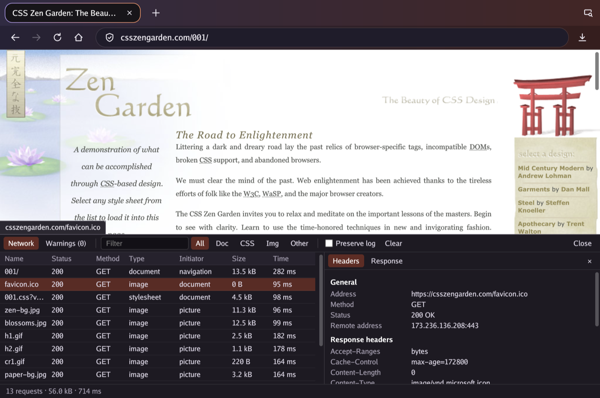
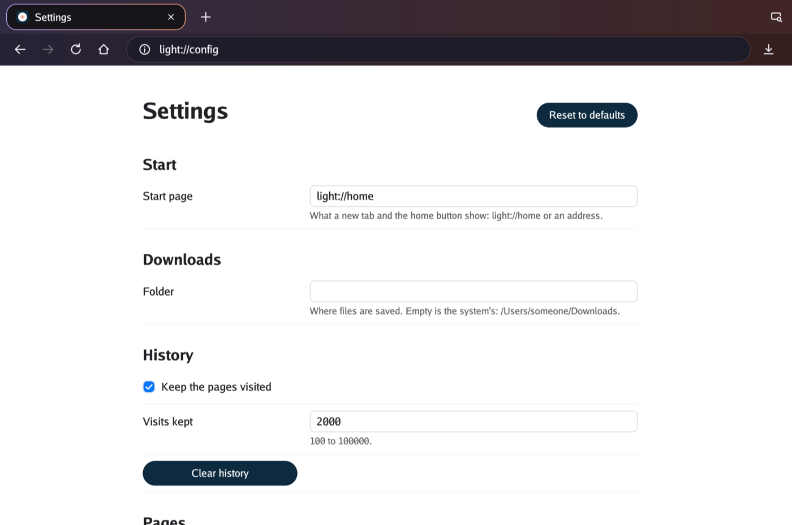
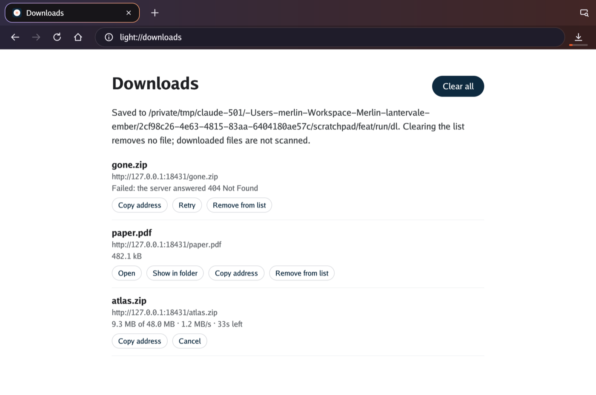

<div align="center">

#  light

**A small web browser, made as a demo of [ember](https://github.com/lantervale/ember).**

[](go.mod)
[](LICENSE)
[](#what-it-does-not-do)
[](https://github.com/lantervale/ember)


<sub>[CSS Zen Garden 001](https://csszengarden.com/001/), fetched from the web and drawn by ember.</sub>

</div>

ember is a 2D game engine in plain Go. Its UI is HTML elements built from Go and styled by a CSS subset. This demo asks
how far that UI goes on pages written for real browsers: it fetches a page, turns it into ember elements and draws it.

It is a demo, not a browser to live in: see [what it does not do](#what-it-does-not-do).

## Highlights

- 🗂️ **Tabs in the title bar**: the header sits where the system's title bar is, as a browser's does (macOS).
- 🧭 **Navigation**: back, forward, reload and stop, an address field, a list of the open tabs, favicons.
- 🌐 **Real pages**: an `http` or `https` address is fetched with its stylesheets, pictures and fonts, through its redirects.
- 🧾 **Other kinds of answer**: a picture alone on a dark page (PNG, JPEG, GIF, WebP, SVG, an ICO holding a PNG; a
  click switches between fitted and its own size), text kinds (CSS, JavaScript, JSON, XML, plain text…) as they were sent.
  The rest (PDF, archives, audio, video, fonts, AVIF…) is downloaded.
- ⬇️ **Downloads**: a button in the navigation row with the progress and the latest files, and `light://downloads`
  with all of them: open, show in folder, cancel, retry, remove. A link with `download`, "Save link as…",
  "Save image as…" and "Save page as…" go the same way.
- ⚙️ **Settings**: `light://config` sets the start page, the dark mode, the downloads folder, the history, the zoom,
  pictures, timeouts, redirects and the User-Agent. They apply at once and are kept between runs.
- 🌙 **Dark mode**: light's own pages on black, the logo's navy and white swapped, and "light" struck through. A
  click on the start page's logo switches it; pages of the web stay as their sites made them.
- 🏠 **Its own pages**: `light://home`, `guide`, `examples`, `scripts`, `about`, `history`, `downloads` and `config`.
- 🕘 **History**: `light://history` lists every visit by day, filtered as you type, kept between runs.
- 🖱️ **Right click**: a menu for what is under the pointer — a link, a picture, selected text, a text field, the
  page, a tab, a request.
- 📄 **View source**: `view-source:<address>`, with line numbers.
- ⚡ **JavaScript**, in a build with the `v8` tag: a page's classic scripts run in V8 against a DOM of light's own:
  the page as its parser made it, of which ember draws what it has an element for. Elements, events, timers, `fetch`, `localStorage`, `history`. `light://scripts` shows it.
- 🍪 **Cookies**: one jar for every request, by the rules browsers apply (`Secure`, `HttpOnly`, `SameSite`, the
  public suffixes), kept between runs; those of other sites than the page's are blocked unless the settings say
  otherwise (below).
- 🛠️ **Developer tools**, in the manner of Firefox's: a tool bar of tabs, a panel whose top edge is dragged to size
  it, dark or light as the dark mode says. Its Network tab lists every request of the tab (below), its Console tab
  what the page said (below), its Warnings tab what ember's ui refused, and its Storage tab the cookies and the
  `localStorage` of the page's site, to read only, as they stood when the tab was shown.
- 🔍 **Zoom**, from 80 % to 200 %, and **text you can select** and copy.
- 🧱 **All of it is ember**: the header, the menus, the tools and the page are plain ui elements and stylesheets.

| | |
|---|---|
|  |  |
|  |  |
|  |  |
|  |  |

## Get started

You need Go 1.27, [Task](https://taskfile.dev) (`brew install go-task`) and a
[WebGPU-capable GPU](https://github.com/lantervale/ember/blob/main/docs/01-getting-started/README.md).

light builds on the ember cloned beside it, through a Go workspace:

**1.** Clone ember and light side by side, and tie them:

```sh
mkdir lantervale && cd lantervale
git clone https://github.com/lantervale/ember.git ember
git clone https://github.com/lantervale/light.git light
go work init ./ember ./light
```

**2.** Fetch ember's WebGPU library (one time only):

```sh
(cd ember && task wgpu)
```

**3.** Run it, on the start page or at an address:

```sh
cd light
go run ./cmd/light
go run ./cmd/light https://csszengarden.com
```

The start page has a tile for CSS Zen Garden; any address typed in the field works the same way.

That build runs no script. The JavaScript engine is V8 (through [gost-dom/v8go](https://github.com/gost-dom/v8go)
and cgo), behind the `v8` build tag, on macOS and Linux, amd64 and arm64:

```sh
task run                                                      # or:
CGO_CXXFLAGS=-nostdinc++ go run -tags v8 ./cmd/light light://scripts
```

V8's headers need its own libc++, hence `CGO_CXXFLAGS`. The binary grows from about 34 MB to about 106 MB.
Without the tag, or on Windows, light builds as before and `light://config` says no engine is built in.

> ⚠️ light does not build against ember's `main` yet: it uses parts of ember's ui that have not landed there
> so far. Until they do, `go.mod` pins an older commit and the steps above fail at the build.

## Shortcuts

Cmd is Command on macOS and Control elsewhere.

| Keys | What they do |
|------|--------------|
| Cmd+T, Cmd+W | A new tab, close the tab |
| Cmd+L | The address field |
| Cmd+R | Reload, or stop a page that is loading |
| Cmd+[ and Cmd+] (Alt+Left and Alt+Right off macOS) | Back, forward |
| Cmd+Y on macOS, Ctrl+H elsewhere | The history |
| Cmd+Shift+J on macOS, Ctrl+J elsewhere | The downloads |
| Cmd+, | The settings |
| Cmd++, Cmd+-, Cmd+0 | Zoom in, zoom out, the actual size |
| Cmd+Alt+U on macOS, Ctrl+U elsewhere | The page's source, in a new tab |
| F12, or Cmd+Alt+I on macOS, Ctrl+Shift+I elsewhere | The developer tools |
| Alt+Up and Alt+Down, or Ctrl+P and Ctrl+N, in the console's line | What was typed before, and after |
| Right click | The menu of what is under the pointer; arrows, Enter and Escape work in it |

## The developer tools

F12 opens them under the page, each tab its own. The tool bar has a tab for each tool, the count of the console's
errors in red (a click shows them), Preserve log and the close button. The top edge of the panel is a handle: drag it
to size the panel, between 120 points and the window less 80; a double click on it gives the panel its own height
back. The height is kept between runs (`tools_height` in `config.json`).

### Inspector

The Inspector tab shows the page as its markup, in three panes, read-only:

- **The tree**: elements with their attributes, text cut short, the doctype of a page of the web. The first two levels
  are open, the rest opens at a click on its triangle, and an element of more than 200 children lists them 200 at a
  time. A click selects a row; Up and Down move by a row, Left closes or goes to the parent, Right opens or goes to the
  first child. `flex`, `grid` and `scroll` badges tell what an element is. The tree follows the page as scripts change
  it and keeps the selection while its node lives. Search HTML finds by tag, `#id`, `.class` or text, Enter going to the
  next match.
- **On the page**: the element under the pointer in the tree is tinted, content, padding, border and margin each in
  its colour, with a label of its tag, id, classes and size; the selected one keeps a dashed outline while the
  Inspector shows. The picker, the button left of the search, selects the element clicked in the page without the
  page getting the click, Escape leaving it; "Inspect element" in the menu of a right click does the same. In the
  console, `$0` is the selected element.
- **Rules and computed**: the rules that match the selected element, the strongest first, the style attribute among
  them, each with its sheet and line (a click opens the source), its `@media` and `@layer`, what another declaration
  overrides struck through. Beside them its box, margin to content, and its computed style: what was declared or
  inherited, or every property with Browser styles ticked.

What it does not show: comments and the page's own doctype, which the Document does not keep, pseudo-element rules,
and declarations ember's ui refused (those are in Warnings). A page of light's own is inspected too.

### Network

- A row for each request, each hop of a redirect its own: its status on the colour of its kind, its method, its
  domain (a padlock for `https`), its file, who asked (the navigation, the document, a picture, or the script and
  the line of a `fetch` or an `XMLHttpRequest`), its type in a word (`html`, `css`, `js`, `json`, `png`…), the bytes
  the server sent, those read once a gzip encoding is undone, and how long it took.
- A request light refuses to send (a script's `POST`) is a blocked row, with its sign, and a failed one is tinted.
- The chips keep one kind: All, HTML, CSS, JS, XHR (what scripts asked for through `fetch` or `XMLHttpRequest`,
  whatever was answered), Fonts, Images, Media, Other. There is none for WebSockets: light opens none. The field
  filters by address.
- A click on a column's name sorts by it, a second the other way, a third no more.
- A click on a row shows its headers and its response beside the table, the `Cookie` header it was sent with and
  the `Set-Cookie` headers it was answered among them; the pointer over a row names its address
  in the status bubble. The bin empties the list; a new page does too, unless Preserve log is checked.

### Console

The Console tab of the developer tools lists what the shown tab's page said, the newest line last, and follows it
unless you scrolled up:

- `console.log`, `info`, `warn`, `error` and `debug`, warnings and errors on their tint with their sign, several values on a
  line printed as a console prints them (`{a: [1, "two"]}`, `<p#id.class>`, `ƒ name()`, an error with its stack),
  `%s %d %i %f %o %O` filled in and `%c` left out. `assert`, `count`, `time`/`timeLog`/`timeEnd`, `dir`, `trace` (with
  the calls that led there), `group`/`groupEnd` (indented), `table` (as plain text) and `clear` work too.
- The exceptions nothing caught and the promises rejected with no handler, as errors whose calls unfold at a click
  on their triangle; the scripts
  that did not load or were skipped; the requests of scripts that failed or were refused.
- On the right of a line, the script and the line it is from: a click shows that script's source in a new tab (at
  its top: the source view does not scroll to a line). An inline script's lines count from its own first. An
  address in a line is a link that opens it in a new tab.
- A line said again in a row is listed once, with how many times.
- The bar filters by text and by level: Errors, Warnings, Info, Logs and Debug are each on or off. XHR lists the
  requests of scripts among the lines (method, address, status and time), Requests every request, and CSS what
  ember's ui refused in the page's sheets; the three are off at first. The bin empties the console; a new page does
  too, unless Preserve log is checked.
- The line at the bottom evaluates in the page: Enter runs it, its value comes back under it (a string in its
  quotes) or the error it threw, and `$_` is the last value. A `let` or a `const` a line begins with stays for the
  next lines. Alt+Up and Alt+Down (or Ctrl+P and Ctrl+N) walk what was typed before in the tab. A page without a
  script gets its scripts' context the first time a line is run.
- The text selects and copies as a page's does.
- In a build without the engine, or with JavaScript off in the settings, the tab says so and its line takes nothing.

Not there: the arrows alone for the history and Shift+Enter for a line of several (ember's text field keeps its
keys to itself), completion, and values you can unfold.

## Settings

`light://config` (Cmd+,) shows them; a change applies at once and is written to `config.json`. A value out of its
bounds, or a file that does not read, falls back to the default, setting by setting.

| Setting | Default | Overridden by |
|---------|---------|---------------|
| Start page (a new tab, the home button) | `light://home` | The address argument, at launch only |
| Dark mode (light's own pages; a click on the start page's logo switches it too) | Off | |
| Downloads folder | The system's (`~/Downloads`) | `--downloads`, `LIGHT_DOWNLOADS` |
| Keep the pages visited | On | |
| Visits kept (100 to 100,000) | 2,000 | |
| Zoom of web pages (80 to 200 %) | 100 % | |
| Load pictures | On | |
| Run JavaScript (in a build with the `v8` tag; none runs otherwise) | On | |
| Follow a page that refreshes elsewhere at once | On | |
| Keep the cookies sites set, and send them back | On | |
| Those of other sites than the page's too (third-party cookies) | Off | |
| Request timeout (1 to 300 s) | 30 s | |
| Redirects followed (0 to 20) | 10 | |
| User-Agent | `light/1.0 (ember)` | |
| Preserve the Network log in new tabs | Off | |
| Requests kept in each tab's Network panel (100 to 10,000) | 1,000 | |

Pictures, JavaScript and refreshes apply to pages loaded afterwards. The page also clears the history, clears the cookies and resets every setting.
`--dir` (or `LIGHT_DIR`) names the folder the settings are kept in (see [below](#where-things-are-kept)); `light --help` lists the command line.

## Downloads

- What light cannot show is downloaded, and so is a link with a `download` attribute, an answer sent as an
  attachment, and what "Save link as…", "Save image as…" and "Save page as…" name.
- A file goes to the downloads folder under a free name: light never writes over a file. It is written as
  `<name>.lightdownload` and takes its name once whole; a cancelled or failed download leaves nothing behind.
- **Downloaded files are not scanned**, and light never opens or runs one by itself. "Open" and "Show in folder"
  act only on your click, only on a download of light's that is complete, through the system's own opener.
- There is no size cap, no pause and no resume: a download that failed is fetched again from its start by "Retry".
- A navigation that turns out to be a download is fetched twice: once to learn its kind, once to save it.
- The list is kept between runs, 500 entries at most. A download that a quit interrupted shows as failed.

## Where things are kept

`history.json`, `downloads.json`, `config.json`, `storage.json` (what pages kept in `localStorage`, 5 MB an
origin) and `cookies.json` (the cookies that outlive a run, readable by you alone: they are what signs you in) are
in light's folder of your config folder
(`~/Library/Application Support/light` on macOS). `--dir` or `LIGHT_DIR` names another folder. A hidden run (`EMBER_HIDDEN`)
not given one keeps them in memory.

## What it does not do

- Built without the `v8` tag it runs no script: a page that builds itself in JavaScript shows little, and what a
  `noscript` holds is shown, as with JavaScript off. A font a script loads (Typekit…) is then replaced by the next
  family of its list.
- **Fonts**: a page's `@font-face` fonts are fetched when its text first needs them, TrueType, OpenType, WOFF and
  WOFF2, and each is a row of the Network panel asked by its stylesheet, sent with the sheet's address as its
  `Referer` (the site alone to another site) and the cookies of its address. Until one lands the text shows in the
  next family, then the page is laid out again: `font-display` is always `swap`, and an icon shows as nothing
  meanwhile. A font is 16 MB at most and has 30 s to come; one that fails is a warning of the page. A variable font
  shows its default weight, no bold or italic is made up from a regular face, colour fonts and collections are
  not read, and an icon font that writes its icons as words (ligatures, as Material Icons) shows the words. A font
  of another site is used whatever its `Access-Control-Allow-Origin`, where a browser refuses it without one.
  The fonts of a sheet reached by `@import` are not fetched, as the sheet is not. light keeps its own
  `User-Agent`: Google Fonts answers it with TrueType files of whole families, where it gives browsers WOFF2 cut
  by `unicode-range`.
- It sends a form with a GET only, and no credentials: a page that asks to sign in (401, 407) says so and stops.
- Its cookies follow the rules of RFC 6265bis, with these limits: no partitioned cookies (CHIPS), no Cookie Store
  API, no `Set-Cookie` from a `<meta http-equiv>`, no cookie without a name. A cookie holds 4,096 bytes, a site
  180 cookies, the jar 3,000, and none lasts over 400 days; the least lately sent go first. A `Secure` cookie
  goes over `https` only, and so not to `http://localhost`. `http` and `https` are two sites for `SameSite`. A link
  opened in a new tab and a download count as asked by you, not by the page. A cookie of the run alone ends when
  light quits, not when its tab closes. With cookies off, those kept stay in their file, unsent, until cleared.
- It has no cache: every page shown for the first time in a tab is fetched, and nothing is revalidated (no 304).
- It follows redirects (301, 302, 303, 307, 308) and a refresh of 0 seconds, as many in a row as the settings say,
  to `http` and `https` only. A refresh that waits is left alone.
- It reads gzip only: no Brotli, no zstd, and it does not ask for them.
- It holds a page's answer in memory, 64 MB at most, and lays out the first 512 kB of a text. A download is
  streamed to its file instead.
- It decodes PNG, JPEG, GIF, WebP (lossy and lossless, with alpha; an animated one is not drawn) and SVG. AVIF and
  BMP are downloaded.
- An `img` shows one picture of its `srcset`, or of its `<picture>`'s first `<source>` light draws: the smallest
  that fills the slot `sizes` gives in the view, at one pixel a point (`img.currentSrc` reads it). It is chosen as
  the page is built and when a script changes the `img`, not again on a resize; a `media` other than `min-width`
  and `max-width` does not hold, and a `<source>` a script changes is not looked at again.
- It does not scan what it downloads, and neither pauses nor resumes a download.
- It zooms web pages only, not its own pages. The keys zoom one tab; the setting is the zoom of the others.
- It colours no syntax in a source, and completes no address from the history.
- A Control+click is not a right click on macOS.
- It draws what ember's ui draws. What is missing is listed in ember's guide:
  [What is missing](https://github.com/lantervale/ember/blob/main/docs/05-ui/10-missing.md).

## Limits of its JavaScript

What runs: classic scripts, inline and `src`, in document order, with `defer` and `async`; `on…` attributes; the
DOM (the tree as the parser made it: comments, the doctype, text, `svg`, `noscript`, `template` and its content,
`script` and `style` where the page has them, every attribute as written; classes, `style`, `dataset`, `innerHTML`
and `outerHTML` written as browsers write them, selectors, forms' values), which a framework hydrates (tested with
React 18); events with
capture, bubbling and `preventDefault`; `DOMContentLoaded` and `load`; timers, microtasks,
`requestAnimationFrame`; `fetch` and `XMLHttpRequest`; `getBoundingClientRect` and the `offset…` and `client…`
sizes; stylesheets (a `<style>` or a `<link rel="stylesheet">` added, edited, moved or removed by a script, its
`sheet` with `cssRules`, `insertRule` and `deleteRule`, a rule's `selectorText` and `style`, `document.styleSheets`,
`new CSSStyleSheet()` with `adoptedStyleSheets`, `CSS.supports`), applied once a frame; `document.fonts` (`ready`, `status`, `check()`, `load()`, `loading` and `loadingdone`; it lists no `FontFace` and takes none); `getComputedStyle`; `localStorage` and `sessionStorage`; `history.pushState` and `popstate`; `MutationObserver`,
`CustomEvent`, `URL`, `TextEncoder`, `atob`. One context a page, closed when the tab leaves it.

What does not:

- **Modules** (`type="module"`, `import()`), workers, service workers, WebSockets, iframes,
  shadow trees, custom elements, canvas contexts, WebGL, media, IndexedDB, XPath. A module is skipped and the
  Console says so; the others are absent or answer with nothing. An `svg` is in the tree and scripts change it:
  it is drawn as one picture, again the frame after a change, with `currentColor` the colour of its text, but the
  page's rules do not reach the shapes inside it (`svg path { fill: … }`), and `<use>`, text, clipping, masks and
  filters are not drawn; scripts run once the whole page is read, so `document.write` writes nothing.
- **Requests** other than GET and HEAD: a script's POST is refused, with a warning in the Console. The headers a
  script sets are not sent. Another origin's answer is readable only with a matching `Access-Control-Allow-Origin`.
- **Cookies**: `document.cookie` reads and sets the browser's cookies for the page, those marked `HttpOnly` kept
  from it, and `navigator.cookieEnabled` says whether the setting is on. A script reads no `Set-Cookie` header of
  what it fetched.
- **Styles**: the page's `@import` rules are not followed, and a rule ember's ui does not read applies nothing,
  whoever inserted it. A stylesheet moved among the others is read again, and what scripts inserted in it kept.
  `getComputedStyle` answers what ui computed: lengths in px, colours as `rgb()` when they were written in
  hexadecimal and as written otherwise, a width and a height as laid out at the last frame; an element added since
  the last frame answers little until the next. A rule's `style` is its text read again: no `CSSKeyframeRule`,
  no `CSSStyleSheet` of an `@import`, no `ownerRule`.
- **Scrolling** from a script (`scrollTo`, `scrollX`…), `blur()`, `IntersectionObserver` and `ResizeObserver`
  (each tells once, as if everything were in view), and the observers of performance.
- **Keys**: in a focused text field, scripts hear typed characters and Enter, not the other keys.
- A script that runs longer than 2 seconds is stopped and reported in the Console. A page's timers get 8 ms a
  frame; what is left waits for the next. A page holds 500,000 nodes at most.
- Content security policies are not read: a page's scripts run whatever its policy says.
- A page with scripts is not kept when the tab leaves it: Back fetches it again. The scripts of a background tab
  wait until it is shown.

## Under the hood

A page goes through four steps:

1. **Fetch**: the address, through its redirects; the answer is shown by its type.
2. **Read the HTML** with [golang.org/x/net/html](https://pkg.go.dev/golang.org/x/net/html). ember has no HTML parser.
3. **Build**: each element becomes the ember element of the same name (`ui.Div`, `ui.P`, `ui.Img`…), with its id,
   classes, inline style and attributes; each `<link rel="stylesheet">` is fetched meanwhile.
4. **Style and draw**: the sheets go to ember as they are. ember parses the CSS, lays the page out and draws it.

What light changes in a page before showing it is one short table in `internal/web/adaptations.go`. light shows it
at `light://about`.

Every request goes through one `http.RoundTripper` (`pkg/netlog`), which is how the developer tools see them all,
wrapped in another (`pkg/cookies`) that adds the cookies of the one jar and takes those each answer sets, a redirect's
hops each on their own. A request's context says which page it is for (`cookies.Within`), or which page a
navigation began on (`cookies.From`): that is how a third party and a cross-site request are known.

| Package | What it holds |
|---------|---------------|
| `cmd/light` | The entry: the window, the folders and their overrides, the World. |
| `light` (the root) | The logo, embedded. |
| `internal/app` | The screen: header, navigation, status bubble, light's own pages, the pages of the other kinds, the history, downloads and settings pages, the context menu, shortcuts. |
| `internal/web` | An address turned into a page: the answer read by its kind, HTML built as a ui Document, and every adaptation made to it. |
| `internal/menu` | The context menu as a ui element. |
| `internal/dom` | The DOM a page's scripts see: a JavaScript prelude over one Go function that reads and changes the parser's tree, the ui Document following what it shows of it. |
| `internal/devtools` | The developer tools' panel as ui elements. |
| `internal/shell` | The system's command that opens a file or shows it in its folder. |
| `pkg/tabs` | Plain Go, no ember: tabs, each one's back and forward, what a typed address means, the `light://` addresses. |
| `pkg/history` | Plain Go: the visits, by day, filtered, capped, and their file. |
| `pkg/downloads` | Plain Go: the downloads, each one's state and progress, free file names, partial files. |
| `pkg/config` | Plain Go: the settings, their defaults and bounds, and their file. |
| `pkg/content` | Plain Go: which kind of answer a media type is (one table), file names for saving. |
| `pkg/fetch` | Plain Go: one GET with redirects, limits, charset and the Refresh header, read whole or as a stream. |
| `pkg/netlog` | Plain Go: the record of a tab's requests, and the transport that fills it. |
| `pkg/script` | The JavaScript engine's boundary: V8 with the `v8` tag, nothing without. No ember. |
| `pkg/console` | Plain Go: what a tab's scripts said, capped, a line said again counted, filtered by level and text. |
| `pkg/storage` | Plain Go: what pages keep by origin, and its file. |
| `pkg/cookies` | Plain Go: the cookie jar, its rules, the transport that applies them, and its file. |

Dependencies go one way: `cmd` → `internal` → `pkg`.

## Development

The tests need no GPU and no network: pages are served by a local test server, and clicks and keys are simulated.
They write nothing in your config or Downloads folders, and open no file: the system's opener is replaced by a fake.

```sh
task test             # go vet ./... and go test ./..., without and with the v8 tag
task lint             # golangci-lint, without and with the v8 tag (after task golangci:boilerplate, once)
```

A screenshot without opening a window:

```sh
EMBER_HIDDEN=1 EMBER_CAPTURE=shot.png EMBER_CAPTURE_FRAME=30 go run ./cmd/light
```

## Licence

Code under [MIT](LICENSE). The pages in the screenshots belong to their authors.
